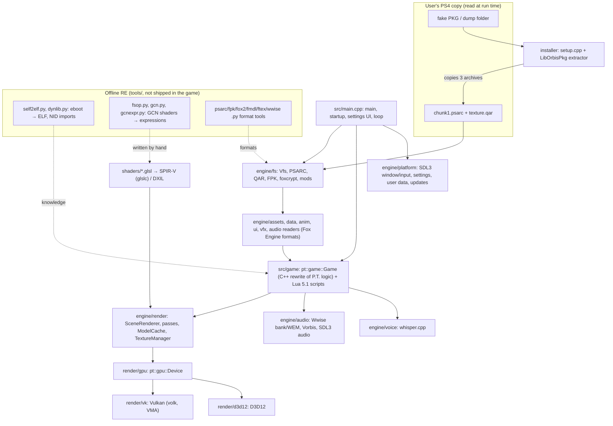

# Part 1: pt-pc survey

Created: 202610311425 (Asia/Jakarta). pt-pc commit `8966e89` (branch `main`, 2026-10-24).
Plan: `plan/202610311331-pt-pc-analysis-and-sif-port/202610311331-plan.md`, Part 1.
All paths below are relative to `D:\Games\PS4\pt-pc` unless written otherwise.

## 1. README summary (`README.md`, read in full, 193 lines)

### Headline finding: pt-pc is a reimplementation, not an emulator

- `README.md:23-26`: "It is not an emulator. The game logic was rebuilt in C++ from the original's behaviour, with Vulkan and DirectX 12 renderers; every level, model, texture, sound, script and cutscene is read at run time from your own copy of the PS4 game."
- `README.md:28`: the port runs on its own engine, "Hallway Engine".
- `README.md:54-56`: the installer copies only three game archives (`chunk1.psarc`, `texture.qar`, `pathid_list_ps4.bin`). "The eboot, modules and system files are not used."
- `README.md:173-174`: the shadPS4 emulator was used as the reference for how the original behaves and to check frames against it.

So pt-pc never loads `eboot.bin`, never resolves NIDs at run time, and never translates GNM command buffers. It reads the game's **data** and runs its own C++ engine that copies the game's behaviour. The PS4 code was studied offline (see `tools/self2elf.py`, `tools/dynlib.py`, `tools/gcn.py`, `docs/formats/self.md`), not run.

Term: **HLE** (high-level emulation) means replacing system library calls with host code while still running the original program. pt-pc does not do this either; it replaces the whole program.

### What it claims

- Plays the whole teaser, including the voice part (`README.md:31-32`).
- Platforms: Windows 10/11 x64, Linux x86-64 glibc 2.38+, macOS 14+ (`README.md:41-42`).
- GPU: Vulkan 1.3; MoltenVK on macOS; optional ray queries for ray-traced effects; DLSS needs RTX (`README.md:43-46`).
- Microphone for one section; key fallback via `pt.ini` `[voice] key = J` (`README.md:47-48`).

### What the user must supply

- Own copy of P.T. US release CUSA01127, as a console dump folder or a fake PKG; folder name does not matter, the game recognises it by its files. Other regions accepted, differences logged (`README.md:36-39`).
- Store PKGs are not accepted: "encrypted for the console that owns it, and nothing here decrypts it" (`README.md:39-40`).

### How to run

- Installer `P.T.PC.Port.Setup.exe` (Windows) or Linux setup binary; points at a dump or fake PKG; copies the three archives next to the port (`README.md:52-56`).
- User data (settings, saves, logs, cache) in `data/` next to the exe; on macOS in `~/Library/Application Support/pt-port/pt/` (`README.md:70-71`).
- Startup update check against GitHub Releases, disable with `[network] check_updates = 0` (`README.md:72`).

### Features the port adds (`README.md:85-130`)

Display modes, upscalers (FSR 3.1/4, DLSS, XeSS), frame generation, DLSS 5 neural rendering, path tracing, graphics presets, photo mode, free camera, loop browser, museum, controller feedback (DualSense/DS4 speaker), Game+, speedrun timer with LiveSplit, third-person view, VR via OpenXR, extra languages, mods (file replacement and Lua scripts).

### Build (`README.md:132-160`)

- Windows: VS 2022 Build Tools, LLVM clang-cl, Vulkan SDK, CMake 3.28, Ninja; `tools\build_pt.bat release` gives `build\release\pt.exe` (`README.md:134-137`).
- CMake fetches SDL3, zlib, volk, VMA, glm, Dear ImGui, stb, Lua 5.1, libogg, libvorbis, whisper.cpp, Google libsbc; downloads Whisper and Silero models and upscaler SDK files, SHA-256 checked (`README.md:138-140`).
- Linux: GCC 13 or clang 17, Vulkan headers, `glslc` (`README.md:143-145`). macOS via Homebrew (`README.md:147-150`).
- Tests: CMake targets `pt_tests`, `pt_mods_test`, etc.; `tools/walkthrough.py` plays the game headless through `tests/walkthrough/` scripts and checks the log (`README.md:152-154`).
- Installer: native C++ setup plus a C# LGPL extraction helper using LibOrbisPkg to read fake PKGs (`README.md:156-157`).

### Known limitations (from README)

- Only the US release was tested (`README.md:36-39`).
- Intel Mac app never run; VR only tested on a simulated runtime (`README.md:64-65`, `README.md:120-121`).
- Radeon validation of FSR Ray Regeneration pending; DS4 speaker output unverified (`README.md:98`, `README.md:115`).
- Voice audio stays English; microphone word is always "Jack" (`README.md:125-126`).

## 2. License (`LICENSE`)

- MIT, "Copyright (c) 2026 LoreanXavier" (`LICENSE:1-21`). Allows use, copy, modify, merge, publish, distribute, sublicense, and sell, as long as the copyright and permission notice are kept in copies or substantial portions.
- Extra note (`LICENSE:23-25`): covers the port's own code only; P.T. content belongs to Konami; `third_party/` and build-time libraries keep their own licenses. `README.md:184-185` says the same.
- Meaning for us: we may reuse or fork pt-pc code (for example its PKG/SELF/format tools, platform layer, Vulkan backend) if we keep the MIT notice. Pieces like LibOrbisPkg in the installer are LGPL (`README.md:157`) and need separate handling. Per-library licenses: `docs/licenses/` and `third_party/*_notices/`.

## 3. `.gitignore` (data-handling policy)

`.gitignore:1-31` excludes game data and dumps (`/game/`, `/dump/`, `extracted/`) and every game format (`*.pkg *.bin *.elf *.self *.prx *.sprx *.qar *.sfo *.at9 *.fpk *.ftex *.fmdl *.fox2 *.bnk *.wem` ...). The same idea as our rule 7. Exception: `third_party/texture_models/realesr-general-x4v3-x2.bin` (`.gitignore:13`), though that folder is not tracked at this commit (see `git ls-files`).

## 4. Docs (`docs/`, 30 markdown files, about 4,100 lines)

All 30 files were read in full by a subagent; the claims marked ✔ below I re-checked myself.

### PS4 binaries, PKG, and how the game is accepted

- ✔ `docs/formats/self.md:3-5`: "All three executables in CUSA01127 are fake-signed SELF files". `tools/self2elf.py` makes a plain ELF; `tools/dynlib.py` dumps imports/exports, "named through a NID database when one is given"; field names follow shadPS4.
- ✔ `docs/formats/self.md:27-28`: every segment is flagged signed or signed+blocked; "None is encrypted or compressed, so the segment data is plaintext." (Term: **SELF** = Sony's signed wrapper around an ELF executable; a **fake-signed** SELF has plaintext segments, so it can be turned back into an ELF without keys.)
- ✔ `docs/formats/pkg.md:64-70`: PKG content (PFS, XTS-AES-128) needs the console-bound EKPFS key for retail packages; only fake PKGs open with the public fake keyset. That is why only fake PKGs and dumps are accepted.
- `docs/formats/pkg.md:86-98` (subagent): the port reads only `chunk1.psarc`, `texture.qar`, `pathid_list_ps4.bin`; eboot, `sce_module`, `sce_sys` are not used.
- ✔ `docs/installer.md:58-62`: setup and helper "never decrypt Sony-encrypted content"; two refusals: an encrypted (store) PKG, or input that is not P.T.
- ✔ `docs/installer.md:79-94`: P.T. is recognised by content: a PSARC (`PSAR` magic) + a QAR footer, plus `pt14_` level names in `pathid_list_ps4.bin` or a known title ID (CUSA01127, CUSA01114, CUSA01098) from the PKG content ID or `sce_sys/param.sfo`. No whole-file hash check.
- `docs/installer.md:67-77` (subagent): accepted inputs: fPKG, console dump folder, extracted fPKG, a shadPS4 install folder, a folder with one PKG.

### How the original PS4 code was studied

- ✔ `docs/formats/fsop.md:6-8`: GCN shaders are read by `tools/fsop.py`, disassembled by `tools/gcn.py`, lifted by `tools/gcnexpr.py`; "The port's GLSL shaders were written from these." (Term: **GCN** = the AMD GPU instruction set used by the PS4 GPU.)
- `docs/formats/fsm.md:9`, `docs/formats/vfx.md:10`, `docs/formats/motion.md:190` (subagent): facts "read from the game's code"; `docs/formats/audio.md:212`: `audio_dump.py` needs capstone.
- Hypothesis: the author statically disassembled the eboot (after `self2elf.py`) to recover behaviour; no doc names the disassembler used.
- No PS4 code runs at run time (`docs/installer.md:128-129`, `docs/formats/pkg.md:98`, subagent). The voice part replaces the PS4 engine with whisper.cpp (`docs/formats/voice.md:17`).

### Formats documented (`docs/formats/README.md:7-20`)

psarc/fpk (`psarc.py`, `fpk.py`); pkg/self (`pkginfo.py`, `self2elf.py`, `dynlib.py`); foxcrypt (`foxcrypt.py`); fox2 (`fox2.py`, `foxhash.py`); fmdl/geom (`fmdl.py`, `geom.py`, `meshview.py`); textures (`qar.py`, `ftex.py`, `pathcode.py`); fsm/motion (`fsm.py`, `motion.py`); fsop (`fsop.py`, `gcn.py`, `gcnexpr.py`); ui (`ffnt.py`, `lng.py`, `uif.py`); vfx (`vfx.py`); audio (`sbp.py`, `wwise_bank.py`, `wwise_names.py`, `audio_dump.py`); voice (`voice_check.py`, `voice_mic_session.ps1`). Most are **Fox Engine** formats (Konami's engine, also used by MGSV): fox2 v0x35 "as in MGSV" (`docs/formats/fox2.md:8-10`), FMDL 2.03 (`docs/formats/fmdl.md:3-6`), Wwise 2013 banks v88 (`docs/formats/audio.md:3`).

### Other docs (one line each, from the subagent)

`modding.md`, `modding-quickstart.md`, `lua_api.md` (mods, glTF, Lua API with stubs at `lua_api.md:214-242`); `audio-surround.md` (5.1/7.1, spatial); `controller-features.md` (DualSense/DS4 haptics, speaker, gyro); `linux.md`, `macos.md` (platform ports); `photo_mode.md`; `updates.md` (GitHub Releases update check); `upscaling.md`; `vr.md`; `installer.md`. `controller-features.md:14,35,46` cites `gameplay.md` and `dualsense-output-2026-10-20.md`, which do not exist in `docs/` (also `CMakeLists.txt:59` cites `docs/gameplay.md`, `CMakeLists.txt:251` cites `docs/rhi.md`; neither is tracked).

### Limitations stated in docs (subagent)

Unnamed audio events/buses (`audio.md:182-184`); `.mog` transitions not decoded (`motion.md:253`); `foxhash.py` wrong for strings ≥ 64 bytes (`fox2.md:123-125`); EU/JP data never seen (`installer.md:101-109`); VR, DLSS-FG, DS4 speaker untested on hardware (`vr.md:3-5`, `upscaling.md:48-53`, `controller-features.md:37-47`).

## 5. Directory map (depth 3) with purposes

Source: `git ls-files`; `src/` purposes from a subagent that read file names and file headers, spot-checked by me (`src/engine/fs/vfs.cpp`, `src/main.cpp`, `src/decomp/`).

| Folder | Purpose |
|---|---|
| `.github/` (`ISSUE_TEMPLATE/`, `workflows/`) | Funding, bug template, macOS CI build and publish workflows |
| `assets/` (+ `fonts/`) | Port's own icon, manifest, RC template, `extras.pak` (port data pack "PTDP"), Noto fonts with OFL licenses |
| `cmake/` (+ `toolchains/`) | Build modules (section 6) and Linux cross toolchain |
| `docs/` (+ `formats/`, `licenses/`, `media/`) | User docs, reverse-engineered format specs, third-party licenses, README gif |
| `examples/mods/<name>/` | 11 sample mods (level.json edits, glTF models, WAV/PNG replacements, Lua event logger) |
| `installer/Extractor/` | C# helper using LibOrbisPkg to read fake PKGs |
| `installer/Native/` | C++ setup and updater (Windows/Linux), archive manifest, update route queue |
| `installer/Tests/` | C# tests for the extractor |
| `shaders/` | 121 GLSL shaders of the port's own renderer (gbuffer, lighting, path tracing `pt_*`, RT `rt_*`, upscaling, VFX, UI) |
| `src/main.cpp` | Entry point, startup, settings UI, main loop (8,678 lines) |
| `src/decomp/` | Only an empty `.gitkeep` (0 bytes). Hypothesis: reserved for decompiled reference code that is not published |
| `src/engine/anim/` | Skeletons, rigs, GANI/motion codec, demo (cutscene) files |
| `src/engine/assets/` | FMDL model, FTEX texture, geom collision readers; glTF loader for mods |
| `src/engine/audio/` | Audio engine and DSP, Wwise bank/WEM parsing, Wwise Vorbis decoding, subtitles, controller speaker, spatial output |
| `src/engine/core/` | Logging, JSON, crash reports, parallel_for, path/string hashing (PathCode64, StrCode64), localized string tables |
| `src/engine/data/` | Fox2 entity data reader |
| `src/engine/fs/` | VFS and archive readers: PSARC, QAR, FPK, foxcrypt, PTDP pack, mods, prefetch, game-folder and release checks |
| `src/engine/physics/` | Triangle collision world |
| `src/engine/platform/` | OS layer: input, gyro, settings, user data, display policy, HTTP, update check, signing, Discord, LiveSplit, virtual pad |
| `src/engine/render/` | Scene renderer and passes; subfolders `gpu/` (API-neutral `pt::gpu::Device`), `vk/` (Vulkan device), `d3d12/` (+`backend/`, `present/`: D3D12 device and presenters), `upscale/` (DLSS/FSR/XeSS/MetalFX/frame generation) |
| `src/engine/script/` | Lua 5.1 VM wrapper and sandboxed mod runtime |
| `src/engine/ui/` | UIF/UIA/UIGB/UILB UI files, FFNT fonts, lang files, text layout |
| `src/engine/vfx/` | VFX node-graph files, effects, lens flares |
| `src/engine/voice/` | Microphone and whisper.cpp recognizer |
| `src/engine/xr/` | OpenXR host |
| `src/game/` | P.T. gameplay: stages, floor loop, player, traps, puzzles, demos, save data, Lua bindings, museum, speedrun |
| `src/game/lisa_date/` | The "Lisa" encounter feature (P.T.-only) |
| `src/game/ui/` | Game menus, options, PC settings, photo mode, subtitles, credits |
| `tests/` (+ `pad/`, `walkthrough/`) | ~80 C++ unit tests; scripted input routes for headless playthroughs |
| `third_party/` (`ffx_linux/`, `upscaler_notices/`, `voice_notices/`) | Small FSR Linux shim and license notices only |
| `tools/` | Python format tools (psarc, qar, fpk, fox2, fmdl, ftex, gcn, self2elf, dynlib, pkginfo, wwise...), `build_pt.bat`, `walkthrough.py`, `package.py` |
| `tools/ci/`, `tools/linux/`, `tools/macos/`, `tools/dx12/` | Release, signing, cross build, app bundle, DX12 tool fetch |
| `tools/vk_null_swapchain_layer/`, `tools/xr_test_runtime/` | Test helpers: Vulkan layer without a real swapchain, fake OpenXR runtime |

Deepest folders are `src/engine/render/d3d12/{backend,present}` (depth 4).

### Engine vs game boundary

- No file in `src/engine` includes `game/...`; dependency is one way (subagent). Both are compiled into one library `pt_engine` (`CMakeLists.txt:33-34`, `:58`).
- But `src/engine` is not game-neutral: ✔ `src/engine/fs/vfs.cpp:19-52` hard-codes `chunk1.psarc`, `texture.qar`, 12 P.T. `.fpk` paths and US archive sizes; ✔ `vfs.cpp:85` names CUSA01127/CUSA01114; `src/engine/fs/pt_release.h:21`, `src/engine/render/gpu_types.h:175` (`kMatLisaHairShadow`), `src/engine/render/model_cache.cpp:22` (subagent). The formats in `src/engine/{assets,data,fs,anim,ui,vfx,audio}` are Fox Engine formats.
- ✔ `pathid_list_ps4.bin` is not referenced in `src/` (`grep -rn pathid_list src` gives nothing); only the installer uses it to recognise the game.

### Any PS4 code execution in `src/`? No.

The subagent grepped for `sceKernel`, `libkernel`, `libSce`, `Gnm`, `orbis`, `sprx`, `NID`, `elf`, `self`, `gcn`: no PS4 loader, NID resolver, HLE library, or GCN translator. Matches were false positives (`vorbis`; `kEbootFrame = 1024` timing constant at `src/engine/audio/sound_engine.cpp:29`; NVIDIA ELF check at `src/engine/render/upscale/neural_native.cpp:273`; AMD GCN PC-GPU detection at `src/engine/render/upscale/upscale.cpp:520`). PS4-binary tools exist only offline in `tools/` (`self2elf.py`, `dynlib.py:124`, `gcn.py:1145`, `gcnexpr.py`) and are not referenced by `CMakeLists.txt`.

## 6. Lines of code

Script: `repository/tools/loc_count.py` (stdlib only; lists files with `git --no-optional-locks ls-files`, counts physical lines of tracked text files, skips binaries; asserts every file is counted). Run from the main folder:
`py -3.14 -I repository\tools\loc_count.py "D:\Games\PS4\pt-pc" repository\tools\data\pt-pc-loc.json --depth 3`.
Output: `repository/tools/data/pt-pc-loc.json`. 1,026 tracked files.

### Per language (physical lines, blanks and comments included)

| Language | Files | Lines |
|---|---:|---:|
| C++ (`.cpp`) | 307 | 126,238 |
| C/C++ headers | 257 | 39,350 |
| Python | 49 | 18,126 |
| GLSL (`.glsl .vert .frag .comp`) | 125 | 9,564 |
| Text (mostly `tests/walkthrough`, `tests/pad` route scripts) | 172 | 5,130 |
| Markdown | 41 | 4,402 |
| CMake | 15 | 2,048 |
| Objective-C++ | 1 | 841 |
| C# | 2 | 151 |
| Others (YAML, JSON, Shell, Batch, PowerShell, RC, Lua, XML, ...) | ~37 | ~700 |

### Per folder (lines)

| Folder | Files | Lines | Note |
|---|---:|---:|---|
| `src/main.cpp` | 1 | 8,678 | One huge file: startup, settings UI, main loop |
| `src/engine/*` | 325 | 99,224 | `render` 39,193; `core` 13,779; `audio` 11,391; `platform` 9,281; `anim` 4,594; `vfx` 3,854; `ui` 2,535; `fs` 2,222; `assets` 1,771; `voice` 1,364; `xr` 1,354; `physics` 932; `script` 667; `data` 486 |
| `src/game` (+ `lisa_date`, `ui`) | 131 | 41,588 | `game` 27,144; `game/ui` 10,803; `game/lisa_date` 3,641 |
| `src/decomp` | 1 | 0 | `.gitkeep` only |
| `tests` (+ `pad`, `walkthrough`) | 252 | 17,785 | 13,302 C++/GLSL test code; 4,483 lines of route scripts |
| `tools` (+ subfolders) | 62 | 21,688 | Python format tools, CI, platform helpers |
| `shaders` | 121 | 9,460 | |
| `installer` | 18 | 6,303 | `installer/Native` 6,144 |
| `cmake` | 14 | 1,374 | |
| `docs` | 32 | 4,300 | |

Total `src/` is about 143,700 lines: engine 99k, game 42k, main.cpp 9k.

## 7. Build system

### `CMakeLists.txt` (674 lines) and `CMakePresets.json`

- CMake ≥ 3.28, project `pt_port`, C/C++ (+OBJCXX on macOS) (`CMakeLists.txt:1-13`); C++20, C11, static MSVC runtime (`:15-19`). Linux: static libstdc++/libgcc, only glibc from the system (`:21-30`).
- Presets: Ninja + `clang-cl`; `debug` = Debug, `release` = RelWithDebInfo + `PT_REQUIRE_UPSCALERS=ON` (`CMakePresets.json`).
- Globbed sources: `pt_engine` STATIC = `src/engine/**` + `src/game/**` + `src/decomp/**`, minus `src/engine/render/d3d12/backend/` (`CMakeLists.txt:33-36`, `:58`). No separate engine library.
- Version `1.0.8` and the GitHub Releases update URL are generated into `pt_version.h` (`:41-56`). Option `PT_GAMEPLUS` (default ON) (`:59-72`).
- Executables `pt` (developer) and `pt_release` (`PT_RELEASE_LOCKS=1`), both from `src/main.cpp` (`:98`, `:121-128`); `dxgi.dll` delay-loaded (`:104-111`).
- Installer targets `pt_setup` (only with a payload), `pt_updater`, `pt_setup_linux` (`:153-199`).
- Shaders: each `shaders/*.vert|frag|comp` → `glslc --target-env=vulkan1.3 -O` → `build/.../shaders/*.spv`; target `pt_shaders` (`:218-243`).
- Windows options `PT_D3D12_SHADERS` (GLSL → SPIR-V → SPIRV-Cross → DXC) and `PT_D3D12_BACKEND` (`:245-256`). The comment at `:251` says "the game does not link it yet", but `src/main.cpp:8074`, `:8298` use `#ifdef PT_D3D12_GAME`. Question for Part 4.
- About 80 test executables (`:264-674`). No `add_test`/`enable_testing` (grep finds none), so tests are plain programs, not CTest.

### `cmake/` modules

| File | Lines | Role |
|---|---:|---|
| `Dependencies.cmake` | 265 | FetchContent of libraries, Whisper/Silero model downloads; builds `pt_thirdparty`, `pt_sbc`, `pt_vorbis` |
| `Upscalers.cmake` / `UpscalersLinux.cmake` | 390 / 239 | Download and stage FidelityFX, Streamline/DLSS, XeSS, MinHook |
| `D3D12.cmake` / `D3D12Backend.cmake` / `D3D12Shaders.cmake` | 29 / 116 / 82 | D3D12 backend library and shader path |
| `OpenXR.cmake` | 54 | OpenXR loader and test runtime |
| `MacOS.cmake` | 52 | MoltenVK, MetalFX |
| `version.cmake`, `build_id.cmake`, `write_upscaler_manifest.cmake`, `check_upscaler_policy.cmake`, `StageRuntimeFiles.cmake` | 10-36 | Generated headers, release checks |
| `toolchains/linux-x86_64-clang-cross.cmake` | 53 | Linux cross build from Windows |

### `tools/build_pt.bat`

Hard-codes VS 2022 Build Tools `vcvars64.bat`, `C:\Program Files\LLVM\bin`, `VULKAN_SDK` default `C:\VulkanSDK\1.4.357.0`; runs `cmake --preset` then `cmake --build`; prints `BUILD_OK ...\pt.exe`.

### Fit with the user's machine (Part 0)

User has VS 2026 with clang-cl inside VS, but **no Vulkan SDK** (`C:\VulkanSDK` missing) and no standalone LLVM (`C:\Program Files\LLVM` missing). `find_package(Vulkan REQUIRED COMPONENTS glslc)` (`cmake/Dependencies.cmake:5`) would fail. Building pt-pc is not required for our port; if wanted later it needs the Vulkan SDK (ask first) and a build in `work/`.

## 8. Third-party dependencies

Tracked `third_party/` holds only `ffx_linux/` (FidelityFX Linux shim, 176 lines), `upscaler_notices/`, `voice_notices/`. Everything else is fetched at configure time:

| Library | Pin | Where | Used for |
|---|---|---|---|
| Vulkan SDK + `glslc` | system | `cmake/Dependencies.cmake:5` | Renderer API, shader compiler |
| SDL3 | `release-3.4.16`, static | `:8-12` | Window, input, gamepads, audio device, dialogs (`src/main.cpp:1-2`, `:8055`) |
| zlib | `v1.3.2` | `:18` | PSARC decompression (`src/engine/fs/psarc.cpp:3`), PTDP pack (`src/engine/fs/data_pack.cpp:3`) |
| volk | `1.4.350` | `:20` | Vulkan loader |
| VMA | `v3.4.0` | `:21` | GPU memory allocation |
| glm | `1.0.3` | `:22` | Math |
| Dear ImGui | `v1.92.9b-docking` | `:23` | Settings/debug UI |
| stb | `master` (not pinned) | `:24` | Image decode/write (`src/engine/assets/image_decode.cpp`, `src/engine/render/texture_manager.cpp`) |
| Lua | 5.1.5 | `:25-26` | Game and mod scripts (`src/engine/script/`) |
| Google libsbc | commit `6e50565` | `:32-45` | DS4 speaker audio |
| whisper.cpp + Whisper/Silero models | v1.9.4 | `:52-53`, `:137-139` | Voice recognition |
| zstd | 1.5.7 (decompress, no asm) | `:172-196` | DLSS 5 bundle unpacking only (`src/engine/render/upscale/neural_native.cpp:23`, `:264-266`) |
| HarfBuzz | `14.6.0` (Linux) | `:212-214` | Text shaping |
| libogg / libvorbis | v1.3.5 / v1.3.7 | `:223-254` | Wwise Vorbis decoding |
| ww2ogg codebooks (aoTuV 603) | SHA-256 | `:232-233` | Wwise `.wem` Vorbis codebooks |
| Streamline / DLSS | v2.14.1 / v310.9.1 | `cmake/Upscalers.cmake:183`, `:248` | DLSS, frame generation |
| FidelityFX SDK | v1.1.4, v2.3.0 | `Upscalers.cmake:232`, `:238` | FSR 3.1 / 4 |
| MinHook | v1.3.4 | `Upscalers.cmake:262-265` | DLSS 5 companion |
| XeSS | v3.0.2 | `Upscalers.cmake:279` | XeSS |
| SPIRV-Cross, DXC | pinned | `cmake/D3D12Shaders.cmake:17-20` | Shaders for D3D12 |
| OpenXR SDK | `PT_OPENXR_VERSION` | `cmake/OpenXR.cmake:17-19` | VR |
| MoltenVK | `PT_MOLTENVK_VERSION` | `cmake/MacOS.cmake:25-26` | Vulkan on macOS |
| LibOrbisPkg (C#, LGPL) | — | `installer/Extractor`, `tools/patch_liborbis_readers.py` | Fake-PKG extraction in the installer |

For SIF: SDL3, Vulkan/volk/VMA, glm, ImGui, zlib, stb are generic and reusable. Wwise decoding helps only if SIF uses Wwise (Part 9). Upscalers, whisper, libsbc, OpenXR are not needed.

## 9. Entry point and startup sequence

Entry: `int main(int argc, char** argv)` at `src/main.cpp:7664` (SDL3 `SDL_main.h` included at `:2`, so SDL supplies `WinMain` on Windows). Order:

1. Voice CPU probe early exit (`:7665`); attach parent console on Windows (`:7667-7672`).
2. `ParseOptions` (`:7676`); "tool" runs detected (headless, script/anim/voice/texture tests) (`:7685-7686`).
3. Log: `pt.log` in `data/` (or cwd for tools), old one kept as `pt-previous.log` (`:7687-7705`).
4. Update journal check, may relaunch (`:7706-7709`).
5. Windows: DLSS 5 / frame-generation proxy and ReShade `dxgi.dll` handling (`:7710-7818`).
6. User data folder prep and legacy save migration (`:7841-7944`); log line "pt-port version ..., Hallway Engine" (`:7945`).
7. Crash reporting, `PT_TEST_CRASH` crash tests, free-memory gate (`:7947-7982`).
8. Tool modes: voice test/listen, list pads (`:7983-7999`).
9. **Find and mount game data:** `FindGameDir` (`:8005`, defined `:1163-1225`): `--game` option, folders near the exe, remembered `game_dir.txt`, else the first-run screen that can extract a fake PKG with `extractor/PT.PkgExtract.exe` (`:1208-1213`). Then `vfs.Mount` (`:8010`) → `Vfs::Mount` (`src/engine/fs/vfs.cpp:17-33`) opens `chunk1.psarc` and `texture.qar`; `MissingCorePackages` (`vfs.cpp:55-61`) checks 12 hard-coded `.fpk` paths (`vfs.cpp:39-52`).
10. Anim/script/fox2 test modes (`:8040-8048`); prefetch the two archives (`:8050-8053`).
11. `SDL_Init` (`:8055`), device threads (`:8062`), load `pt.ini` (`:8069-8072`).
12. Choose Vulkan or D3D12, with crash-marker fallback (`:8074-8151`).
13. `SDL_CreateWindow("P.T.", ...)` under a start watchdog (`:8246-8280`).
14. `MountMods` (`:8282`); renderer settings, optional OpenXR (`:8283-8338`).
15. `app.renderer.Init(window, settings)` (`:8357`); DLSS 5 / FG checks (`:8419-8613`).
16. `textures.Init`, `scene.Init`, `ModelCache` (`:8621-8631`).
17. `RunViewer` (stage/texture viewer) or `RunGame` (`:8647-8649`).
18. Shutdown in reverse; maybe start the updater (`:8650-8677`).

`RunGame` (`src/main.cpp:5283`): constructs `pt::game::Game game(vfs, *app.models)` with a `GameConfig` (save `PT_Save_Data.sav`, start floor, seed) (`:5285-5301`); `game.Init(config)` (`:5302`); boot phase "game data" (`:5305`); `game.LoadModScripts` (`:5332`); `sound.Init(...)` (`:5346`); main loop `while (running)` (`:5857`) → `game.Update(step, state)` (`:6438`) → `renderer.BeginFrame` / `scene.Render(camera, draw_items, lighting, dt)` / `renderer.EndFrame` (`:7146-7152`, `:7295-7299`); boot phase "first frame" (`:7302`).

There is no "load eboot → jump to entry point" anywhere. The game is `pt::game::Game` C++ code fed by the game's data files.

## 10. First architecture sketch

Layers: (1) platform (SDL3, OS), (2) data access (VFS + Fox Engine format readers), (3) the rewritten game (`src/game`, driven from `src/main.cpp`), (4) the port's own renderer (Vulkan/D3D12, own shaders), (5) PC extras (upscalers, VR, mods, photo mode). The PS4 executable is only an offline source of knowledge.

### What this means for the SIF port (Hypothesis, to confirm in Parts 6-10)

- The plan assumed pt-pc is a PS4 emulator-style port (loader, NID HLE, GNM translation). It is not. Its approach is **"rewrite the game in C++, read the original data"**. That needs deep knowledge of SIF's own engine and data formats, not of PS4 system libraries.
- Reusable from pt-pc: the method (offline SELF→ELF, NID dumps, GCN disassembly to study behaviour), the PKG/SELF tools, the platform/renderer skeleton (SDL3, `pt::gpu::Device`, Vulkan), the installer's "fake PKG/dump only" policy and recognition-by-content idea, and the headless walkthrough testing idea.
- Not reusable: everything Fox Engine-specific (most of `src/engine/{fs,assets,data,anim,ui,vfx}`) and all of `src/game`, unless SIF also uses Fox Engine (unlikely; to check in Part 9).
- An emulator-style SIF port (load the eboot, HLE libraries) would need different references, such as shadPS4 itself, which the pt-pc README credits (`README.md:173-174`). Part 11 should choose between the two approaches.

## 11. Open questions for later parts

Part 2 (loader and memory):
1. Since pt-pc has no loader, Part 2's checklist (ELF mapping, relocations, TLS, NID linking, memory model) has nothing to read in pt-pc beyond `tools/self2elf.py` and `tools/dynlib.py`. What should Part 2 cover instead? (See Plan changes.)
2. How does `tools/dynlib.py` resolve NIDs, and what NID database format does it expect? Is that database in the repo? (Not in `git ls-files`.)

Part 3 (system layer):
3. There is no HLE of `libkernel`/`libSce*` in `src/`. The equivalent layer is `src/engine/platform` + `src/engine/core` (threads via `parallel_for`, files via `Vfs`). Should Part 3 document that layer instead?

Part 4 (graphics):
4. Is the D3D12 backend actually used by the game? `CMakeLists.txt:251` says no; `src/main.cpp:8074` uses `PT_D3D12_GAME`. Where is `PT_D3D12_GAME` defined?
5. How faithful are the hand-written GLSL shaders to the GCN originals; does any code load PS4 shader binaries at run time? (Grep says no.)
6. Textures are stored untiled (`docs/formats/textures.md`, subagent cites `:196-199`). Would SIF's textures be tiled?

Part 5 (other subsystems):
7. How does `engine/audio` mix and output Wwise events without the Wwise runtime?
8. How are PS4 save data and trophies handled (save path `PT_Save_Data.sav`, `src/main.cpp:5288`)?

Part 6 (specific vs generic):
9. How much of `src/engine` would survive a change of game? (Rough guess: platform, render/gpu, render/vk, core.)
10. What is the "Hallway Engine" boundary in practice, given one `pt_engine` library?

Parts 8-9 (SIF):
11. Is SIF's `eboot.bin` a fake-signed SELF with plaintext segments, like P.T.'s (`docs/formats/self.md:27-28`)? If so, `tools/self2elf.py` logic applies.
12. Which engine does SIF use? It decides whether "rewrite the game" is realistic (pt-pc needed ~42k lines of game code for a short teaser).
13. Is the SIF PKG a fake PKG or a store PKG? pt-pc's tools open only fake PKGs (`docs/formats/pkg.md:64-70`).

## 12. Plan changes needed

1. **Main one:** the plan (Parts 2-5, 10) assumes pt-pc emulates PS4 code (loader, NID HLE, GNM translation). It does not; it is a native rewrite that reads only game data (`README.md:23-26`, `:54-56`). Parts 2 and 3 should be re-scoped to "offline RE tooling (`self2elf.py`, `dynlib.py`, `gcn.py`) + data access layer (VFS, format readers)" and "platform/engine services". Part 4 should cover the port's own renderer instead of GNM translation.
2. Part 10/11 need an explicit early decision: **reimplementation (pt-pc style) vs emulation (shadPS4 style)** for SIF, informed by Part 9's engine identification. Consider adding shadPS4 as a second reference if emulation is chosen (would need the user to provide it; it is not in our folders).
3. Part 0's suggestion stands: use `git --no-optional-locks` for pt-pc.
