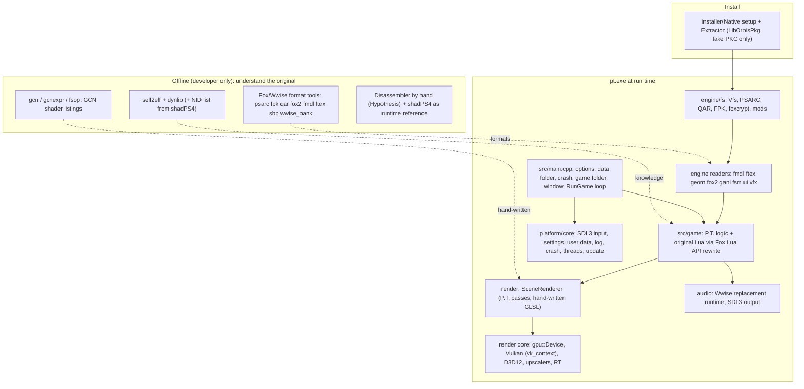

# Part 7: pt-pc synthesis (specific vs generic, testing, architecture)

Created: 202610311759 (Asia/Jakarta). Plan: `plan/202610311331-pt-pc-analysis-and-sif-port/202610311439-plan.md`, Part 7.
pt-pc paths are relative to `D:\Games\PS4\pt-pc` (commit `8966e89`, read-only). This file consolidates Parts 1, 4, 5 and 6:

- `analysis/202610311425-pt-pc-survey/202610311425-analysis.md` (P1)
- `analysis/202610311700-pt-pc-re-toolchain/202610311700-analysis.md` (P4)
- `analysis/202610311738-pt-pc-data-and-services/202610311738-analysis.md` (P5)
- `analysis/202610311746-pt-pc-render-audio-input/202610311746-analysis.md` (P6)

Facts cited there are not re-cited in full here; follow the section references.

## 1. P.T.-specific code: where it is

### Method

New script `repository/tools/marker_scan.py`. It lists tracked files with `git --no-optional-locks ls-files`, counts regex markers, and classifies each file as:

- **"game"**: P.T. markers such as title IDs, `pt14_`, `chunk1.psarc`, `texture.qar`, `pathid_list`, Lisa, hallway, `P.T.`, `PT_Save_Data`, gouge, Jack, subliminal, handy light/flashlight, `och0_`, `SKL_nnn_`, maze A/B/C, nazo;
- otherwise **"fox"**: Fox/Wwise markers such as `fox::`, `FoxPackage`, `StrCode64`/`PathCode64`, `.fpk`, `ftex`, `fmdl`, `fox2`, `qar`, Wwise/`.wem`/`.bnk`, `.sbp`/`.fsm`/`gani`, `/Assets/`, UIF/UIA/FFNT, fsop;
- otherwise **"none"**.

Command: `py -3.14 -I repository\tools\marker_scan.py "D:\Games\PS4\pt-pc" repository\tools\data\pt-pc-marker-scan.csv --paths src shaders tools tests installer`. Output: one CSV row per file (path, lines, hits, class).

**Limit:** this is a heuristic at file level. One `"P.T."` string, such as a window title, puts the whole file in "game". Line shares therefore overstate how specific the code is. The file list is the useful part.

### Result (lines in files of each class)

| Area | Lines | In "game" files | In "fox" files | Marker-free |
|---|---:|---:|---:|---:|
| `src/engine` | 94,297 | 32,993 (34%) | 19,332 (20%) | 41,972 (45%) |
| `src/game` | 41,718 | 28,211 (67%) | 10,152 (24%) | 3,355 |
| `src/main.cpp` | 8,679 | 8,679 | 0 | 0 |
| `shaders` | 9,581 | 61 (2 files) | 0 | 9,520 |
| `tools` | 21,490 | 12,710 | 3,038 | 5,742 |
| `tests` | 18,023 | 7,193 | 977 | 9,853 |
| `installer` | 6,239 | 6,239 | 0 | 0 |

(Line totals differ slightly from Part 1's `loc_count.py` because this scan only reads code-like extensions.)

### P.T. markers inside `src/engine` (the "generic" engine), grouped

| What | Files (scan hits) | Nature |
|---|---|---|
| Game identification | `fs/vfs.cpp` (35: hallway, `chunk1.psarc`, `texture.qar`, `pt14_`), `fs/pt_release.h` (title IDs), `fs/game_folder.h` (archive names), `fs/mod_level.cpp` (`pt14_hallway` example), `platform/user_data.cpp` (`PT_Save_Data`) | Data identity; replace per game |
| Text tables | `core/*_text.h`, 13 languages (70-107 hits each: "P.T.", Lisa, flashlight, CUSA01127) | Content; replace |
| Product name strings | `core/crash_report.cpp`, `core/crash_upload.cpp`, `platform/update_check.cpp`, `platform/discord_presence.cpp`, `render/renderer.cpp`, `render/upscale/streamline.cpp`, `fs/psarc.cpp` | Strings; configurable |
| Gameplay actions in input | `platform/input.cpp` (19 "gouge"), `input.h`; `xr/xr_host.cpp` (12 "gouge"); `platform/settings.*` (flashlight options) | P.T. action layer (P5 §3, P6 §2) |
| Rendering features | `render/scene_renderer.*`, `scene_post.cpp` (subliminal), `scene_frame.cpp`, `scene_lighting.h`, `scene_rt_full.cpp`, `upscale/scene_upscale.cpp` (HandyLight/flashlight), `gpu_types.h` + `model_cache.cpp` (LisaHairShadow, `och0_`) | P.T. scene passes (P6 §6) |
| Animation | `anim/sim_bones.cpp` (player jacket bones `SKL_*`), `anim/anim_test.cpp` | P.T. data in code |
| Voice | `voice/voice_recognizer.cpp` ("Jack") | P.T. feature |

Plus the Fox-marker files: everything in `fs/{qar,fpk,fox_crypt}`, `assets`, `data`, `anim` readers, `ui` readers, `vfx`, and the Wwise audio core (P5 §1-2, P6 §5).

**Conclusion:** `src/engine` is a P.T. engine with a reusable core. The truly game-neutral parts are the marker-free 45%: `render/gpu`, `render/vk`, most of `render/d3d12`, `vk_context`, the pipeline cache, upscalers, most of `platform`, `core/{log,parallel_for,json}`, `physics`, `script`. Workarounds found earlier: the stale `CMakeLists.txt:251` comment (P6 §1), the Vulkan-leaking `SceneRenderer` (P6 §6), and textures bypassing Vfs (P5 §1).

## 2. Subsystem matrix

Maturity is based on README claims, docs and tests: **High** = ships and is covered by tests or the walkthrough; **Med** = ships with limits; **Exp** = experimental or unverified.

| Subsystem | Main files | Approach | Maturity | Class |
|---|---|---|---|---|
| Executable / PS4 code | none at run time; `tools/self2elf.py`, `dynlib.py`, `gcn*.py` | Offline RE only; game logic rewritten (P1 §1, P4 §5) | n/a | Generic PS4 tools |
| Startup / app shell | `src/main.cpp` | One 8.7k-line file: options, data folder, crash, game folder, device, window, renderer, `RunGame` (P1 §9) | High | P.T. (structure generic) |
| Data access | `engine/fs/vfs.*`, `psarc`, `qar`, `fpk`, `fox_crypt`, `mods`, `file_prefetch` | Path-based `ReadFile` with mod override → packages → archive → loose file (P5 §1) | High | Interface generic; readers Fox; mount P.T. |
| Game identification | `fs/game_folder.h`, `fs/pt_release.h`, installer | Recognise by content + title ID (P5 §1, §6 below) | High | Configurable |
| Format readers | `engine/{assets,data,anim,ui,vfx}` | Native C++ parsers of Fox formats (P5 §2) | High | Fox |
| Game logic | `src/game/*` (41.7k lines) | C++ rewrite + original Lua scripts with re-implemented Fox Lua API (P5 §4-5) | High (whole game playable, `README.md:31-32`) | P.T. |
| Script VM | `engine/script/lua_vm.*`, `mod_lua.*` | Lua 5.1 wrapper + sandboxed mod VM | High | Generic |
| Renderer core | `render/gpu/*`, `render/vk/*`, `vk_context.*`, `render/d3d12/*`, pipeline cache | Own RHI, Vulkan default, D3D12 selectable (P6 §1, §6) | High (Vulkan), Med (D3D12, since 2026-10-15) | Generic |
| Scene rendering | `render/scene_*`, `model_cache`, `texture_manager`, 121 GLSL shaders | Hand-written passes and shaders from GCN listings (P4 §4, P6 §6) | High | P.T. (+ Fox texture/model input) |
| Upscalers / frame generation / RT | `render/upscale/*`, `raytracing*` | SDK wrappers (DLSS, FSR, XeSS), RT queries | Med-Exp (`README.md:98`) | Generic |
| Audio | `engine/audio/*`, `game/game_sound.*` | Own Wwise runtime replacement; SDL3 callback output (P6 §5) | High | Output generic; core Wwise; packages Fox/P.T. |
| Input | `platform/input.*`, `virtual_pad`, `gyro`, controller feedback | SDL3 → PS4 raw-pad bits → P.T. actions, per-frame poll (P6 §2) | High | Raw layer generic; actions P.T. |
| Video | none | Not needed for P.T. (real-time cutscenes) (P6 §3) | n/a | n/a |
| Voice | `engine/voice/*` | whisper.cpp + Silero VAD for "Jack" | Med | P.T. feature, generic library |
| Settings / user data / saves | `platform/settings.*`, `user_data.*`, `game/save_data.*` | INI file, `data/` folder, two-slot binary saves (P5 §3) | High | Parser generic; struct and layout P.T. |
| Logging / crash / threads | `core/log`, `crash_report`, `crash_upload`, `parallel_for` | Mutex logger, minidumps, Sentry upload with consent, pool of up to 8 threads (P5 §3) | High | Generic (upload configurable) |
| Update / packaging | `platform/update_*`, `http`, `ed25519`, `installer/*`, `tools/package.py`, `tools/ci/*` | Signed GitHub-release updates, journal rollback (P5 §3) | High | Configurable |
| VR | `engine/xr/*`, `game/vr_play.*` | OpenXR | Exp (simulated runtime only, `README.md:120-121`) | Generic host, P.T. play |
| Extras | museum, speedrun/LiveSplit, photo mode, Game+, lisa_date, Discord | Port-added features | High-Med | P.T. (LiveSplit/Discord generic) |
| Mods | `fs/mods.*`, `mod_level.*`, `script/mod_lua.*`, `examples/mods` | File override + level edits + Lua events | High | Layer generic; level edits P.T. |
| Testing | `tests/*`, `tests/walkthrough`, `tools/walkthrough.py` | Unit executables + headless scripted playthrough (§3 below) | High | Method generic, content P.T. |

## 3. Tests, walkthrough, examples, installer, assets

From a review subagent; key lines re-checked by me ("checked").

### Unit tests (`tests/`)

- **82 `*_test.cpp` files** (`ls tests/*_test.cpp | wc -l`, checked) plus helpers (`test_strcode.cpp`, `dualsense_hid_probe.cpp`, `route_fake_tool.cpp`, `screen_capture.cpp`) and GLSL compute test shaders (`*.comp`).
- **How they run:** each test is a plain executable linked to `pt_engine` (`CMakeLists.txt:135-138`, `:264-283`). No CTest (no `add_test`, Part 1). Each file has its own small `Check`/`Expect` with a failure counter, and `main` returns non-zero on failure.
- **GPU tests** compile a `.comp` shader with glslc and receive its SPIR-V path as a define (`CMakeLists.txt:291-325`).
- **Some tests read the real game dump** through `--game` (`tests/audio_test.cpp:32`, `:981`).
- **Generic:** the platform, settings, unicode-paths, display, audio-device, controller-HID, `parallel_for`, crash-upload and WinINet tests. **P.T.:** render passes, archive/lisa_date/photo/save/player, gouge/outro/peephole input, Wwise audio.

### Walkthrough testing (`tests/walkthrough/` 141 routes, `tests/pad/` 19, `tools/walkthrough.py` 2,502 lines)

- **Script format:** `[frame] op args...`, parsed in `src/game/input_script.cpp:166-334`. Command kinds:
  - raw input (`move`, `look`, `key`, mouse, pad `ptap`/`paxis`/`pgyro`/`ptouch`);
  - semantic steps (`stap`, `swait`, `sstep`);
  - expectations (`sexpect <state> <value>`);
  - waypoints (`goto`, `gfile`, `face`);
  - screenshots;
  - many P.T.-only ops (`slisa*`, `sarchive*`, `sdemo`).
- **Expectation output:** results are written to the log as `expect ok frame N` / `expect FAILED frame N` (`input_script.cpp:1351-1354`, checked).
- **Runner:** for each scenario, `walkthrough.py` runs `pt.exe --game … --headless --frames N --demo-rate … --input-script <route> --width 1280 --height 720 --seed 1` (`tools/walkthrough.py:2373-2376`, checked). Each run has a private settings file and save folder, a fixed language, a temp work folder and an 1800 s timeout. Save fixtures are built as raw bytes in Python (`:22-31`).
- **Judging is by log only:**
  - ordered regex milestones (`expect`, `:2413-2423`);
  - forbidden patterns between markers (`forbid`, `:2425-2431`);
  - LiveSplit command order;
  - the result is `PASS/FAIL name: k/n milestones` with exit code 1 on failure (`:2483-2493`); `--jobs` runs scenarios in parallel.
  - Screenshots are saved but not compared.
- **Reusable method:** headless mode + fixed seed + frame-based deterministic input script + structured `area: event` log lines + ordered/forbidden regex checks. Per game, only the ops, state names and milestone regexes change.

### Examples (`examples/mods/`, 11 mods)

`added-table` (glTF add with collision), `event-logger` (Lua events), `flashlight-click` and `radio-tone` (sound replacement by media ID), `hide-pictures`, `red-hallway` and `replace-basket` (`level.json` edits), `wall-pictures` (PNG texture override), plus three disabled templates (character, level `.fox2`, native `.fmdl`). The mechanisms (file override, level edit, Lua events) are generic; the paths, IDs and formats are P.T./Fox.

### Installer (`installer/`)

- **`Native/setup.cpp` (327 lines) + `setup_core.h` (2,382):**
  - pick a PKG or a dump folder (`setup.cpp:198-199`);
  - detect the source (`IsPackage` checks `\x7FCNT`, plus `IsPsarc`, `IsQar`, `ConfirmPt`; `setup_core.h:126-198`);
  - extract PKGs through the bundled .NET `PT.PkgExtract.exe` (`setup.cpp:104`);
  - copy the three archives into `CUSA01127/` (`setup_core.h:105`, `:347`);
  - unpack the program from an embedded payload (`:473-515`);
  - write the install manifests, take the icon from the source's `icon0.png`, create a shortcut;
  - headless `--install`, `--self-test` etc. (`setup.cpp:250-279`).
- **`updater_core.h`:** downloads only changed files (with HTTP range requests for small changes), SHA-256 checked against the signed manifest, aborts with "Nothing was changed" on mismatch (`:203-216`, `:345-374`).
- **`Tests/Program.cs`:** builds synthetic fake PKGs (P.T. and non-P.T.) with LibOrbisPkg to test the extractor.
- **Class:** payload, staging, update, repair, Ed25519 and range fetch are **generic**; source detection (title IDs, archive names, `pt14_`) is **P.T.**

### Assets (`assets/`)

- Icons (`pt.ico`, `pt.icns`); `pt.manifest` (asInvoker, long paths); `pt.rc.in`.
- Noto fonts with OFL licenses and SHA-256 pins (`assets/fonts/README.md`).
- **`extras.pak`:** the port's own `PTDP` pack (magic checked), used by the port's "Lisa date" mode. CMake builds it with `tools/make_data_pack.py` from `assets/lisa_date` (`CMakeLists.txt:557-566`, checked), but **both are missing from this tree** (checked), so the prebuilt pack is used. Its content was not unpacked; whether it contains anything derived from game data is unverified.

### CI (`.github/workflows/`)

- `macos.yml`: builds macOS arm64/x64, runs only `pt_macos_data_path_test` and `pt_user_data_test`, builds the .NET extractor, makes the app/zip/dmg.
- `publish-macos.yml`: uploads them to a release.
- **No Windows or Linux CI.** Releases are built locally with `tools/ci/release.py` (Inference).

## 4. How the user supplies the game

Sources: `docs/installer.md` (P1 §4, verified there), `installer/Extractor/Program.cs` (P4 §2), `src/engine/fs/game_folder.h` and `pt_release.h` (P5 §1).

- **Accepted inputs** (`docs/installer.md:67-77`): an fPKG of any release, a console dump folder, an extracted fPKG, a shadPS4 install folder, a folder with exactly one PKG, other title IDs (installed with a note), archives under other names.
- **Refused** (`docs/installer.md:58-62`; `Program.cs:48`): store (retail) PKGs, because LibOrbisPkg's `GetEkpfs()` returns nothing for them, and anything that is not P.T. Nothing Sony-encrypted is ever decrypted.
- **Recognition by content** (`docs/installer.md:79-94`):
  - a PSARC (`PSAR`) + a QAR footer (`aq`);
  - plus `pt14_` in `pathid_list_ps4.bin` or a known title ID (CUSA01127/01114/01098) from the content ID or `sce_sys/param.sfo`;
  - no whole-file hash check.
- **Installed copy:** only `chunk1.psarc`, `texture.qar`, `pathid_list_ps4.bin` + a `source.txt` (`Program.cs:68-79`). The eboot, modules and `sce_sys` are not used (`README.md:54-56`).
- **At run time:** `FindGameDir` looks at `--game`, folders near the exe, then the remembered `game_dir.txt`, then shows the first-run screen (`src/main.cpp:1163-1225`, P1 §9). `Vfs::Mount` requires the two archives and checks 12 core packages (P5 §1).

## 5. Consolidated architecture

### Layers

### Startup flow (P1 §9)

1. `main` → options, log, user data, crash reporting.
2. `FindGameDir` → `Vfs::Mount`.
3. SDL init, settings, choose Vulkan or D3D12.
4. Window, mods, `renderer.Init`.
5. Textures, scene, model cache → `RunGame` (`Game::Init` runs P.T.'s setup Lua).

### Data flow

- **Assets:** archive (PSARC/FPK/QAR) → Vfs → Fox readers → CPU structs → `ModelCache`/`TextureManager` (GPU upload, bindless) → `SceneRenderer`.
- **Audio:** `.sbp` → banks + media in memory → Wwise-replacement runtime → SDL3 callback.
- **Logic:** Lua scripts from FPKs → `LuaVm` → bound C++ (`script_bindings.cpp`).
- **Input:** SDL events and state → raw PS4-pad bits → P.T. actions → `Game::Update`.

### Threading (P5 §3, P6 §6)

- **Main thread:** events, input poll, fixed 60 Hz ticks of `Game::Update`, draw collection, all GPU command recording and submit, present, frame cap.
- **Audio:** the SDL3 audio callback thread (mixing and command drain); the spatial-audio thread.
- **Workers:** the `parallel_for` pool (≤ 8), pipeline warmup and cache save, texture decode-ahead, file prefetch, device start, update check, crash upload, Discord, controller speaker, voice.
- **Clocks:** fixed tick for logic; audio `RenderedFrames()` for cutscene sync.

## 6. Glossary

| Term | Meaning |
|---|---|
| **ELF** | Executable and Linkable Format, the standard executable format on Unix-like systems; the PS4 uses a variant |
| **SELF** | "Signed ELF": Sony's wrapper around an ELF, with signed/encrypted segments. Fake-signed SELFs have plaintext segments |
| **eboot.bin** | A PS4 game's main executable (a SELF) |
| **PRX / SPRX** | PS4 dynamic library (shared object), signed variant SPRX |
| **NID** | 11-character ID that replaces a function name in PS4 import/export tables (truncated SHA-1 of the name + suffix, base64) |
| **HLE** | High-level emulation: replace system-library functions with host implementations while running the original program |
| **LLE** | Low-level emulation: emulate the hardware itself |
| **GNM / GNMX** | PS4 low-level graphics API (driver level, writes GPU command packets) / its higher-level helper library |
| **PM4** | AMD GPU command-packet format that GNM writes into command buffers |
| **GCN** | AMD "Graphics Core Next" GPU instruction set; PS4 shaders are compiled to GCN (GFX7) |
| **PSSL** | PlayStation Shader Language, compiled to GCN binaries |
| **OrbShdr** | Footer marker of a compiled PS4 shader binary (`ShaderBinaryInfo`, version 7) |
| **SPIR-V / DXIL** | Shader bytecode for Vulkan / Direct3D 12 |
| **PKG** | PS4 install package |
| **PFS / PFSC** | PlayStation File System image inside a PKG / its compressed inner form |
| **EKPFS** | Key that decrypts a PKG's PFS. Derivable off-console only for fake PKGs |
| **Fake PKG (fPKG)** | Package rebuilt from a dump and signed with public test keys; can be opened off-console |
| **Store / retail PKG** | Official package, encrypted for the console that owns the license |
| **param.sfo** | Metadata file (title, title ID, version, ...) in `sce_sys/` |
| **Title ID / Content ID** | `CUSA24620` / `JP0082-CUSA24620_00-LLSIFACHM0000000` |
| **Dump** | The user's own decrypted copy of an installed game |
| **Fox Engine** | Konami's engine (MGSV, P.T.); formats FPK, QAR, fox2, FMDL, FTEX, etc. |
| **PSARC** | PlayStation archive format (P.T.'s `chunk1.psarc`) |
| **Wwise** | Audiokinetic audio middleware (banks `.bnk`, media `.wem`) used by P.T. |
| **CRI ADX2 / HCA / ACB / AWB** | CRI Middleware audio system / its codec / cue sheet / wave bank, used by SIF |
| **CRI Sofdec2 / USM** | CRI video system / its container, used by SIF |
| **NP / NpToolkit2** | PlayStation Network services / their high-level SDK library |
| **Bindless** | Shaders index a large texture array instead of binding per draw |
| **RHI** | Render hardware interface: the engine's API-neutral GPU layer (`pt::gpu::Device`) |
| **Fixed timestep** | Game logic runs at a constant tick rate (60 Hz), rendering interpolates |
| **Headless** | Running without a window or audio device, for automated tests |

## 7. Checklist: what it takes to make a pt-pc-style port of another game

A "pt-pc-style port" means rewriting the game natively and reading the original data at run time. Status for SIF in brackets (from Parts 2-6).

**A. Legal and input**
1. Accept only the user's own dump or fake PKG; refuse store PKGs; never decrypt Sony content (P4 §2). [SIF: dump available]
2. Recognise the game by content plus title ID; install or reference only what is needed (§4). [SIF: markers to choose: `eboot.bin`, `param.sfo` `CUSA24620`, `live/`, `sound/`]

**B. Understand the original (offline)**
3. Executable to plaintext ELF; imports named. [Done: Part 3 and its follow-up]
4. Every data format documented and readable by tools. [SIF: `ARC`/`cmp` `.pac` not yet parsed; CRI ACB/AWB/USM need readers]
5. Game logic recovered: scripts where they exist, disassembly where they don't. [SIF: **no scripts**; ~20k native functions, Part 3 §5]
6. Shader behaviour recovered: GCN listings → hand-written shaders. [SIF: ~27k shader binaries, `gcn.py` decodes 300/300 sampled (P4 §4); scale is far larger than P.T.'s ~120]
7. Audio behaviour recovered: middleware data model → own runtime. [SIF: CRI ADX2 runtime needed; HCA unencrypted (Part 3 §9)]
8. Video, if any. [SIF: 202 USM videos; pt-pc has nothing]

**C. Build the runtime**
9. App shell, settings, user data, logging, crash reports. [Reusable from pt-pc, MIT]
10. Data layer (Vfs-style) over the game's archives. [Interface reusable; readers new]
11. Renderer: RHI reusable; scene passes and shaders new. [Core reusable]
12. Audio output + middleware runtime. [Output reusable; CRI runtime new]
13. Input mapping from PC devices to the PS4 pad model. [Raw layer reusable; **rhythm timing needs per-event timestamps**, P6 §7]
14. Saves and progress. [New layout]
15. Online features: disable or replace offline. [SIF: rankings, NpToolkit2; plan offline behaviour]

**D. Verify**
16. Headless scripted playthroughs with log expectations (§3). [Method reusable]
17. Frame comparison against a reference: pt-pc used shadPS4 (`README.md:173-174`). [shadPS4 available as source]

**Effort signal for SIF:** items 5, 6, 7 and 8 are much larger for SIF than for P.T. That is the main argument to weigh in Part 8 against an emulation/HLE route, where the original code, shaders (via a GCN recompiler), CRI audio and video would run as they are.

## 8. Corrections to earlier notes

Earlier files are not edited; these corrections apply from now on.

| # | Earlier note | Correction | Source of correction |
|---|---|---|---|
| 1 | Part 0 §2: `savedata/CUSA24620/` is empty | Not empty: 24 files in `sce_sdmemory*` (an `ls | head` cut the output) | Part 2 §1 |
| 2 | Part 0 §2: the 1 MiB DLC are probably all costume packs | Two families: 63 COS (entitlement only) and 117 MUS (one `.awb` each) | Part 2 §7 |
| 3 | Part 1 §5: `CMakeLists.txt:251` "the game does not link [D3D12] yet" left as an open question | The comment is stale; the game links and runs on D3D12 (`cmake/D3D12Backend.cmake:69-73`) | Part 6 §1 |
| 4 | Part 1 §9 and §5 (RunGame): `scene.Render` at `main.cpp:7146` listed as the main render | `:7146` is the VR path; the normal render is `:7295` | Part 5 §5 |
| 5 | Part 1 §11 Q2: is the NID database in the repo? | No; pt-pc ships none, `--nid-db` takes an external file. We use shadPS4's `aerolib.inl` | Part 4 §1, Part 3 follow-up |
| 6 | Part 2 §6: fake vs store PKG cannot be tested | The test exists (LibOrbisPkg `GetEkpfs()`, `Program.cs:48`); still not run by us (needs key material and .NET) | Part 4 §2 |
| 7 | Part 2 §9: UI is "Iggy" (Hypothesis) | No Iggy runtime strings in the eboot; still open | Part 3 §4 |
| 8 | Part 3 §3: 124 of 559 imports named | All 559 named with shadPS4's list; the earlier 124 were confirmed | Part 3 follow-up (202610311655) |
| 9 | Part 5 §3 (input): cited `input.cpp:135-158` for the raw-bit mapping | That range is button-label detection; the mapping is `RawFromButton` (`input.cpp:155-172`) with bits in `input.h:21-38` | Part 6 §2 |
| 10 | Part 1 §6: zstd use (Hypothesis: game data) | Part 1 already concluded "DLSS 5 bundle unpacking only"; consistent, no change | Part 1 §8 |
| 11 | Part 1 §4: "~120 GLSL shaders" | 121 shader files (`.vert/.frag/.comp/.glsl`), 9,581 lines | marker scan |
| 12 | Part 1 §5: "About 80 test executables"; "tests are plain programs (Hypothesis)" | 82 `*_test.cpp`; confirmed plain executables with their own `Check` helpers, no framework, no CTest | §3 above |
| 13 | Part 1 §1/§8: "the source tree builds `extras.pak`" (implied by the README build text) | `tools/make_data_pack.py` and `assets/lisa_date` are missing at this commit; the build uses the prebuilt `assets/extras.pak` | §3 above |

No other contradictions were found between Parts 1-6.

## 9. Open questions (remaining about pt-pc)

1. How `eboot_strings.txt` (input of `audio_dump.py`, `fox2.py`) was made; no tool in pt-pc writes it (P4 §8).
2. Which disassembler the author used for game logic (P4 §5, Hypothesis: interactive, by hand).
3. D3D12 has no PSO disk cache (P6 §6): does it cause stutter on first runs? (Not needed for SIF.)

## 10. Plan changes needed

None. Part 8 should use §2 (matrix), §7 (checklist effort signal) and P6 §7 (reuse by approach) as its evidence base.
