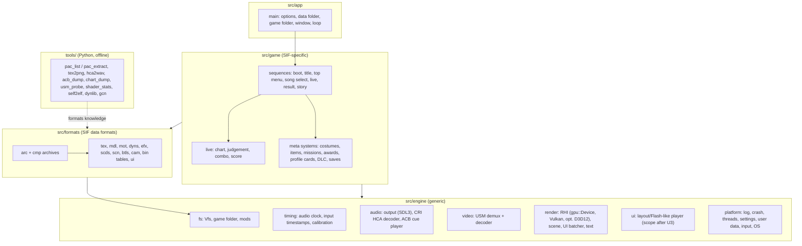

# Plan: SIF PC port, implementation phase (roadmap)

Created: 202610311831 (Asia/Jakarta). Driver prompt: `202610311831-prompt.md` (same folder).
Follows the analysis plan `plan/202610311331-pt-pc-analysis-and-sif-port/202610311439-plan.md` (Parts 0-10, done) and the decision record `plan/202610311813-port-approach-decision/202610311813-plan.md`.

- **Approach:** **A, a native rewrite like pt-pc**, reading SIF's data from the user's own dump at run time.
- **Fallback:** **C, hybrid on shadPS4**, decided at checkpoints CP1-CP4 (decision record §4-5).
- **Main inputs:**
  - gap list `analysis/202610311820-gap-analysis/sif-gap-plan-a.csv` (40 items) and its analysis (U1-U10);
  - pt-pc synthesis `analysis/202610311759-pt-pc-synthesis/202610311759-analysis.md`.

## 1. Architecture

### Principles

1. **The original data is read at run time** from the user's `CUSA24620/` dump. No game data, eboot or key material in the repository (`CLAUDE.md` rule 7).
2. **Generic code is kept apart from SIF code** (`CLAUDE.md` rule 5): `engine/` knows PS4 and PC things; `formats/` knows SIF's file formats; `game/` knows SIF's game rules.
3. **MIT license** for our code. pt-pc code may be copied with its notice. **No shadPS4 code** while on plan A (decision record §3).
4. **Rhythm timing is a first-class layer:**
   - one master clock, derived from *played* audio samples (output latency compensated) plus a user calibration offset;
   - input events carry timestamps on that clock;
   - game logic reads song time, not frame count (Part 6 §7).
5. **Built to make C cheap:** data tools, the timing/input/settings/installer layers and the test runner have no dependency on how the game itself runs.

### Layers



### Data flow per frame (target)

1. Platform pumps events → input events are timestamped on the master clock.
2. The audio thread renders CRI cues → the played-sample counter advances → master clock.
3. Game update reads song time and pending input events → judgement → state.
4. The renderer draws the stage, characters, notes and UI for the interpolated time → present (low-latency mode optional).

## 2. Repository layout (`repository/`)

```
repository/
  README.md                 build + run instructions, legal note (own dump only)
  LICENSE                   MIT (our code)
  THIRD_PARTY.md            notices: pt-pc (MIT), SDL3, volk, VMA, glm, ImGui, stb, zlib, ...
  CMakeLists.txt, CMakePresets.json, cmake/
  src/
    app/                    main.cpp, options, startup (shape of pt-pc src/main.cpp, split into files)
    engine/
      platform/             log, crash, threads, settings, user_data, os, input (from pt-pc, MIT)
      fs/                   vfs, game_folder, mods (pattern from pt-pc)
      timing/               master clock, input timestamps, calibration (new)
      audio/                output (from pt-pc), cri/ hca, acb, awb (new)
      video/                usm (new)
      render/               gpu/, vk/, (d3d12/ later) from pt-pc; scene/, ui_batch, text (new or adapted)
      ui/                   UI runtime (new; scope after U3)
    formats/                arc, cmp, tex, mdl, mot, dyns, efx, scds, scn, btls, cam, tables (new, SIF)
    game/                   sequences, live, meta systems (new, SIF)
  shaders/                  GLSL written for SIF's looks (new)
  tests/
    unit/                   one executable per area, Check() pattern (pt-pc style)
    routes/                 headless input/chart routes (walkthrough style)
  tools/                    Python RE + data tools (existing); data/ = small generated metadata
  docs/formats/             one Markdown spec per SIF format (pt-pc docs/formats style)
work/ (project root, git-ignored)  extracted files, ELFs, listings, builds of references
```

Where pt-pc code comes from:
- `src/engine/platform`, `render/{gpu,vk}` and the audio output → pt-pc `src/engine/platform`, `src/engine/render/{gpu,vk}`, `src/engine/audio/audio_engine.*`, `channel_layout.h`.
- Each copied file starts with the same MIT header as `repository/tools/self2elf.py`. P.T.-specific parts are removed when copied (Part 7 §1 list).

## 3. Milestones (ordered, each with a testable exit)

Checkpoints from the decision record: **CP1** after M2, **CP2** after M4, **CP3** at the start of M6, **CP4** after M7.

| # | Milestone | Exit criterion (testable) | Gap items |
|---|---|---|---|
| M0 | **Toolchain and skeleton** | `cmake --preset debug` builds an empty `sif.exe` with the user's VS 2026 + Vulkan SDK; it opens a window, writes `sif.log`, and a forced crash writes a minidump | P01 |
| M1 | **Archives** | `pac_list.py` parses **3,552/3,552** `.pac` (U1 LZMA fixed, U2 payload offset fixed); `pac_extract.py` extracts any entry to `work/`; sizes match the table; a doc `docs/formats/arc.md` exists | F01, F02 |
| M2 | **Formats readable (CP1)** | Tools convert, for a fixed sample list: `tex/btx` → PNG that looks correct (U4); HCA → WAV playable (U7); ACB cue list printed; one `scds` chart dumped as notes with times; USM header identified (U6); unique shader count known (U8). One `docs/formats/*.md` per format | F03, F07, F14-F17 |
| **CP1** | Review: continue A or switch to C | Recorded in `plan/202610311813-port-approach-decision/` | |
| M3 | **Engine bootstrap** | `sif.exe` finds the dump (CUSA24620 markers), mounts it through Vfs over ARC, draws a texture from the game's data, and plays a music cue through the CRI path; audio output latency measured and logged | P02, P03, P04, F01, F13 |
| M4 | **Vertical slice: one song (CP2)** | One chosen song plays: music + 2D note lanes from `scds` + tap input with timestamps + judgement + combo/score. Judgement timing matches a reference (user's PS4 recording or shadPS4 run) within ±1 frame at 60 fps; a calibration screen exists; a headless autoplay route passes | S02, P04, P05, P07 |
| **CP2** | Review: continue A or switch to C | Recorded | |
| M5 | **Live presentation** | For the same song: stage model, one character model with its dance motion, camera timeline and basic effects, synced to the song clock | F04-F09, F17, S03 |
| M6 | **UI and boot flow** | Boot → title → top menu → song select → live → result, with real UI assets (U3 resolved) and text from `message.pac`. **CP3**: screen and system inventory with an estimate written to `plan/` | F11, F12, S01, S04, S12 |
| M7 | **Systems breadth (CP4)** | Story/talk, costumes/items, missions/awards, profile cards, DLC ownership (user's own add-ons), settings, own save format; all songs selectable | S05-S11, F19, S09 |
| **CP4** | Review | Recorded | |
| M8 | **Video and polish** | USM videos play in sync (song previews, monitors); installer/first-run that recognises the dump; docs so another user can build and run with their own dump | F16, P06, P02 |
| M9 | **Playable release candidate** | All headless routes pass; a manual checklist of all screens is ticked; no game data in the repository (scan check) | all |

Parallel and early:
- **C probe**, after M0, on the user's go-ahead: build shadPS4 in `work/` and record how far SIF boots. This informs CP1.
- **RE track**, ongoing from M1: disassembly notes for the boot flow (`sqBoot`), `ComponentJudgeRing`/`ComponentNote`, the UI runtime (`GfxScene`), table structures. Use the REA tools; Ghidra only if the user approves.

## 4. First tools to build (in order)

| # | Tool (`repository/tools/`) | Purpose | Needed for |
|---|---|---|---|
| 1 | `pac_list.py` fixes + `pac_extract.py` | Correct payload offset, LZMA variant, extract to `work/` | M1 |
| 2 | `arc_names.py` | Recover names of hash-only entries (hash function from samples + candidate strings from the eboot, like `dynlib.py --names`) | M1-M2 |
| 3 | `tex2png.py` | Decode `tex`/`btx` (BC formats, detiling if needed) to PNG in `work/` | M2 |
| 4 | `acb_dump.py`, `hca2wav.py` | `@UTF` cue tables; HCA decode to WAV (may need numpy: ask for a venv) | M2 |
| 5 | `chart_dump.py` | `scds` → note list with times and lanes (CSV) | M2, M4 |
| 6 | `usm_probe.py` | USM chunk listing, video codec ID | M2 |
| 7 | `shader_stats.py` | Unique `OrbShdr` hashes, stage types, sizes; uses `gcn.py` | M2 |
| 8 | eboot helpers | String/xref lookups and name maps for the REA tools; import map from `sif-dynlib-eboot.shadps4.csv` | RE track |
| 9 | `route_runner.py` | Headless runner: `sif.exe --headless --frames N --route r.txt`, then ordered/forbidden log regexes (pt-pc `tools/walkthrough.py` method, Part 7 §3) | M4 onward |
| 10 | `no_assets_check.py` | Fails if a committed file looks like game data (magic `ARC\0`, `AFS2`, `CRID`, SELF, large binaries) | M0 onward |

## 5. Risk register

| ID | Risk | Likelihood | Impact | Mitigation | Switch trigger (to C) |
|---|---|---|---|---|---|
| R1 | UI runtime is a full Flash/Iggy player (U3) | M | H | Resolve U3 at M2; if Flash, scope a minimal player for the formats actually used | UI scope estimate at CP3 is several times the rest |
| R2 | Judgement/scoring rules cannot be recovered exactly (U5) | M | H | Focused disassembly; compare against recorded play | CP2 fails on timing parity |
| R3 | Textures are tiled in an undocumented way (U4) | M | M | GNM tiling knowledge; shadPS4 read as reference only | Texture decoding blocks M2 for long |
| R4 | Shader count/look too large to rewrite (U8) | H | H | Count unique shaders; write a small set of material shaders that approximate | Visual parity of one stage needs most of the shader set |
| R5 | Models/motions/scenes (F04-F09) far bigger than estimated | M | H | Start with one song and one character (M5) | M5 estimate dwarfs M1-M4 |
| R6 | LZMA/compression variant unknown (U1) | L | M | Inspect header; find the decoder in the eboot | — |
| R7 | USM codec is proprietary (U6) | M | M | Identify early (M2); if Sofdec Prime, decoding cost is high | Video becomes blocking for core flow |
| R8 | Audio/input latency on PC too high for fair play | M | H | Small buffers, WASAPI shared/exclusive options, calibration, input timestamps | — (applies to both plans) |
| R9 | Scope creep from game systems (S05-S11) | H | M | CP3 inventory and estimates | CP3 says remaining work is several times the spent work |
| R10 | Legal: accidental inclusion of game data or keys | L | H | `no_assets_check.py`, `.gitignore` for `work/`, review before commits | — |
| R11 | Legal: accidental shadPS4 code copy (GPL) | L | H | Rule in this plan; review | — |
| R12 | Toolchain not installed (Vulkan SDK) | H | L | Ask the user before installing (M0) | — |
| R13 | Single developer time | H | H | Checkpoints with time budgets; the C probe as a reality check | Budgets missed at two checkpoints in a row |

## 6. Open questions (carried)

1. Checkpoint time budgets (CP1 2-3 months, CP2 +4-6 months): to be confirmed by the user (decision record §7).
2. Vulkan SDK install for M0, and when to run the C probe.
3. Disassembler: REA tools only, or Ghidra too?
4. Reference for timing parity at M4: a recording from the user's PS4, or shadPS4 (once the C probe runs)?
5. U1-U10 from `analysis/202610311820-gap-analysis/202610311820-analysis.md` §5.

## 7. Working rules for the implementation phase

- One milestone item (or a coherent group) per session; tick boxes in place; record results in `analysis/<timestamp>-<topic>/` and decisions in `plan/`.
- Code goes in `repository/`. Extracted or derived data goes in `work/` only, never committed. Run `no_assets_check.py` before any commit once it exists.
- Read-only inputs: the SIF assets folder, pt-pc, the P.T. game folder, shadPS4 (`CLAUDE.md`). In pt-pc and shadPS4 use only `git --no-optional-locks`, `log`, `show`, `ls-files`.
- Ask before installing toolchains, creating venvs, downloading tools, or building references (shadPS4) in `work/`.
- Timestamps from PowerShell `Get-Date -Format yyyyMMddHHmm`. Python via `py -3.14 -I`.

## 8. Checklist

### M0 Toolchain and skeleton
- [x] Ask the user to approve the toolchain (Vulkan SDK; VS 2026 clang-cl or MSVC); record the answer
- [x] Create `repository/README.md`, `LICENSE` (MIT), `THIRD_PARTY.md`, `CMakeLists.txt`, `CMakePresets.json`
- [x] Copy pt-pc platform pieces (log, crash, threads, settings, user data, os) with MIT headers; remove P.T. strings. Done for log, crash, threads, os; settings and user data deferred to M3 by user decision 2026-10-31 (see `analysis/202610311838-m0-toolchain-skeleton/`)
- [x] `sif.exe` opens a window, writes `sif.log`, forced crash writes a minidump (exit criterion)
- [x] `tools/no_assets_check.py` and its use before commits

### M1 Archives
- [x] Fix the ARC payload offset (U2) and the `cmp` LZMA variant (U1) in `pac_list.py`
- [x] 3,552/3,552 `.pac` parse; `pac_extract.py` extracts to `work/` (tested on 43 archives; full ≈20.9 GiB run only on user approval)
- [x] `arc_names.py`: name hash function and recovered names (hash matches 83,998/83,998; nameless entries have hash 0, nothing to recover)
- [x] `docs/formats/arc.md`

M1 notes: `analysis/202610311948-m1-archives/`.

### M2 Formats readable (CP1)
- [x] `tex2png.py` for `tex`/`btx` (U4), checked visually on a sample list (40,101/40,101 decode)
- [x] `acb_dump.py` + `hca2wav.py` (U7): done as `acb_dump.py` + native `sif_hca2wav` (vgmstream clHCA, ISC) by user decision; human listening check pending
- [x] `chart_dump.py` for `scds`
- [x] `usm_probe.py` (U6)
- [x] `shader_stats.py` (U8)
- [x] One `docs/formats/*.md` per format (`arc`, `btx`, `scd`, `cri`, `shaders`)
- [x] `BMAR` model/motion reader (added in M2 for CP1 "models"): `bmar_dump.py`, all 8,241 files and 27,392 meshes; motion keys, `BMD`, `MATE` params moved to M5

M2 notes and CP1 evidence: `analysis/202610312004-m2-formats/`.
- [x] **CP1 review** written to `plan/202610311813-port-approach-decision/` (`202610312057-plan.md`: continue A, user decision 2026-10-31)

### M3 Engine bootstrap
- [x] Settings (SIF struct + pt-pc INI parser part) and user-data folder (no legacy migration), copied from pt-pc with MIT headers (deferred from M0)
- [x] Game-folder detection for CUSA24620; Vfs over ARC/cmp
- [x] Renderer core draws a game texture: **SDL3 GPU API** instead of pt-pc `gpu`/`vk` (user decision, M3)
- [x] CRI audio path plays a cue; output latency measured and logged (device buffer 10 ms; end-to-end latency left to M4 calibration; song 0010 confirmed by ear by the user 2026-10-31)
- [x] Music lookup through `music.acb` → stream bank (incl. `sound/dlc`); ADX decoding for `sys.acb` (added at CP1)

M3 notes: `analysis/202610312227-m3-engine-bootstrap/`.

### M4 Vertical slice (CP2)
- [x] Song-ID → music cue mapping (music.acb CueId = song ID; no table needed)
- [x] Master clock from played samples + calibration offset (`AudioOutput::PlayheadMs`, `--calibrate`)
- [x] Input events timestamped on the master clock (SDL event timestamps)
- [x] One song: notes from `scds`, judgement, combo, score (windows from `live_params.bin`; combo/score/hold rules provisional, U5)
- [x] Recover combo, score and hold rules from the eboot (U5) (added in M4): grading, holds, combo and base score recovered with Ghidra and applied to `judge.cpp` (`analysis/202611010903-u5-live-rules/202611010917-analysis.md`)
- [x] U5 remainder: the "combo multiplier" is a per-chart difficulty multiplier (1.0–3.0) and hold ticks (41 ms, 3.3 % of a note) are scored; both applied to `judge.cpp` (`analysis/202611010903-u5-live-rules/202611010949-analysis.md`)
- [ ] U5 leftovers (low priority): result-screen judgement total (128/132 vs 121 for song 0340 Easy), multi-hit notes (note state 3), special-note bonuses, skills
- [x] Human play test of `--calibrate` + `--live 10:4` by the user (added in M4): passed, user 2026-11-01 ("so far so good")
- [x] Timing parity: **closed as "rule parity verified + absolute offset by per-machine calibration"** (user decision 2026-11-01). shadPS4 judgement sweep (`sif_sweep`, 7 runs) confirmed the ms windows, 5 grades incl. Bad and the lane order; the absolute offset cannot be separated from shadPS4's audio delay (c ≈ −100…−88 ms there), and the game itself offers a −80…+80 ms "Judgment Timing Adjustment" (`analysis/202610312309-m4-vertical-slice/202611010048-analysis.md`)
- [x] Port clock: subtract the measured ~18 ms shared-mode delay so offset 0 = on the beat as heard (found by the sweep; added in M4). Now two device periods: press offset +18.0 → −3.5 ms (SD 5.1, 33 hits) (`analysis/202610312309-m4-vertical-slice/202611010859-analysis.md`)
- [x] `route_runner.py` + one passing autoplay route: done as `sif_live_test` (headless autoplay of song 0010/04) and `sif.exe --live 10:4 --autoplay` (583/583 Perfect)
- [x] **CP2 review** written: `plan/202610311813-port-approach-decision/202611011109-plan.md` (continue A, user decision 2026-11-01)

M4 notes: `analysis/202610312309-m4-vertical-slice/`.

### M5 Live presentation
- [x] Stage model + one character model + dance motion + camera timeline + basic effects for the M4 song (met at a basic level, 2026-11-01: `analysis/202611011121-m5-live-presentation/202611011525-analysis.md`)
  - [x] Dance motion keys and 8-influence skinning decoded (`analysis/202611011121-m5-live-presentation/`; plan `plan/202611011117-m5-live-presentation/`)
  - [x] 3D renderer path: stage + character in the live screen (`analysis/202611011121-m5-live-presentation/202611011216-analysis.md`)
  - [x] Dance on the master clock: frame = audio × 60 + `s_music_datas` +0x104 (972 for 0010; `analysis/202611011121-m5-live-presentation/202611011509-analysis.md`)
  - [x] Camera timeline: `BSCM` position/rotation/FOV per frame on the dance clock (`analysis/202611011121-m5-live-presentation/202611011515-analysis.md`, `docs/formats/bscm.md`)
  - [x] Member positions (stage formation) and all 9 members (added in M5): formation is authored in each dance; all 9 drawn (`analysis/202611011121-m5-live-presentation/202611011521-analysis.md`)
  - [x] Render-cost measurement: Release 3.78 ms CPU per frame for stage + 9 CPU-skinned members (CP2 switch signal 2 not triggered)
  - [x] Basic effects: stage node loops on the dance clock (floor-light pillars)
  - [ ] Fidelity follow-ups (not blocking M6): `BTL` timelines (loop selection, camera effects), `ANMT` material tracks, the 9 shader materials, costumes, hair physics, facial animation and lip sync, particles, the pre-music intro

### M6 UI and boot flow
M6 plan: `plan/202611011550-m6-ui-boot-flow/`; notes: `analysis/202611011550-m6-ui-boot-flow/`.
- [x] U3 resolved: no Flash runtime needed (the 36 Iggy movies are unused arcade leftovers, *Hypothesis* strongly supported); `ui2` screens are BMAR quad layouts on a 1920 x 1080 canvas
- [x] UI renderer (`UiScreen`, blended quad pipeline) and boot + title screens (`--title`)
- [x] Text: game fonts via stb_truetype, `font_param` styles, `ui_text` boxes (`analysis/202611011550-m6-ui-boot-flow/202611011642-analysis.md`)
- [ ] `message.pac` strings
- [x] Song select (20_setup), first version: covers, titles, arcade difficulty step; flow title -> top menu -> song select -> live (`analysis/202611011550-m6-ui-boot-flow/202611020043-analysis.md`)
- [ ] Song select: trace the setup logic (difficulty labels, info panel, stage and costume steps, home difficulties)
- [x] In-game, first version: the game's play field (ring positions, note atlas, centre circle) and HUD bar (`analysis/202611011550-m6-ui-boot-flow/202611020049-analysis.md`)
- [x] In-game: HUD score digits follow the live score (`analysis/202611011550-m6-ui-boot-flow/202611020132-analysis.md`)
- [x] In-game: combo counter from `ui_ingame_combo_num` (position guessed; `analysis/202611011550-m6-ui-boot-flow/202611020135-analysis.md`)
- [x] In-game: song progress gauge on the centre circle (`analysis/202611011550-m6-ui-boot-flow/202611020158-analysis.md`)
- [ ] In-game: note cells and long notes as the game draws them, judgement texts (`.fad`), combo position and animation, rank gauge, FULL COMBO marks
- [x] Result screen (95_result), first version: score, max combo, judgement counts and labels, title, cover; number boxes (`analysis/202611011550-m6-ui-boot-flow/202611020059-analysis.md`)
- [ ] Result screen: rank, clear rate, FULL COMBO, records, rewards
- [x] Core loop: result or Esc -> song select (last song kept), Esc -> top menu (`analysis/202611011550-m6-ui-boot-flow/202611020106-analysis.md`)
- [x] Screen load time: vfs keeps 4 unpacked packages and copies only the read entry; song select opens in 1.4 s Release, 1.0 s Debug on return (`analysis/202611011550-m6-ui-boot-flow/202611020117-analysis.md`)
- [ ] Controller input
- [x] Boot → title → top menu → song select → live → result → song select
- [x] **CP3 inventory and estimate** written: `plan/202610311813-port-approach-decision/202611012335-plan.md` (A-full, user decision 2026-11-01; about 187 h estimated, core loop first)
- [x] UI engine features: `ANMT`/`ANVS` tracks, nested and instanced layouts, cross-package parts, `--ui` viewer (`analysis/202611011550-m6-ui-boot-flow/202611012357-analysis.md`)
- [x] Top menu: UI API, clip ids (`ui_animation.bin`), "switch" label clips, mode and entry tables; `--menu` screen with labels, submenus and input (`analysis/202611011550-m6-ui-boot-flow/202611020029-analysis.md`)
- [ ] Top menu polish: wheel easing and dimming, focus highlight, header text (save, `message.pac`)
- [ ] Number textures, 00_common tables (`ui_number`, `numtex_datas`, `ui_category`, `ui_character`)

### M7 Systems breadth (CP4)
- [ ] Story/talk, costumes/items, missions/awards, profile cards
- [ ] DLC ownership from the user's own installed add-ons
- [ ] Settings and own save format
- [ ] All songs selectable
- [ ] **CP4 review** written

### M8 Video and polish
- [ ] USM playback in sync
- [ ] First-run/installer recognising the dump
- [ ] Build-and-run docs for another user with their own dump

### M9 Playable release candidate
- [ ] All routes pass; manual screen checklist ticked; asset check clean

## Completion criteria

M0-M9 ticked, all checkpoint reviews recorded, and the README states how to build and run with the user's own dump.
